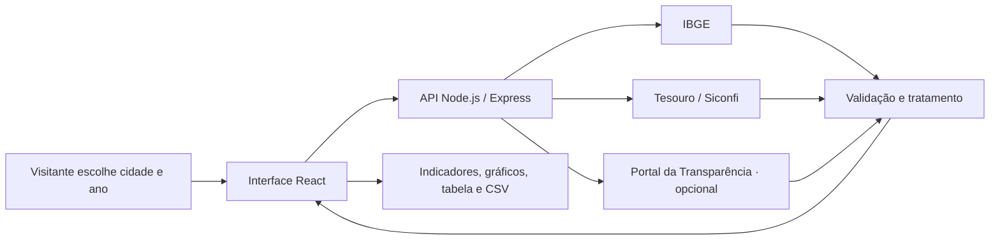

<div align="center">


<br />

**Entenda o orçamento da sua cidade com dados públicos e fontes oficiais.**

Um painel para explorar despesas municipais, conhecer indicadores e transformar números em informação acessível.

[](https://github.com/thiagopauluk200/brasil-aberto/actions/workflows/deploy-pages.yml)


**[Acessar o painel](https://thiagopauluk200.github.io/brasil-aberto/)** · **[Conhecer as funcionalidades](#-funcionalidades)** · **[Executar localmente](#-executar-localmente)**

</div>

---

## 🇧🇷 Sobre o projeto

O **Brasil Aberto** é uma plataforma de visualização de dados públicos dos municípios brasileiros. A proposta é aproximar a população das informações sobre sua cidade, reunindo consultas a fontes oficiais em uma interface simples de explorar.

Quanto o município pagou em saúde? Qual é a participação da educação nas despesas? Qual a diferença entre um valor empenhado e um valor efetivamente pago? O painel ajuda a investigar essas perguntas com filtros, gráficos e acesso à origem dos dados.

Desenvolvido como projeto de portfólio, reúne desenvolvimento de interface, construção de API, integração com serviços externos e tratamento de dados orçamentários. É uma iniciativa independente, sem vínculo governamental.

## ✨ Funcionalidades

| Recurso | O que você pode fazer |
| --- | --- |
| **Busca por município** | Encontrar cidades por nome ou UF a partir do cadastro oficial do IBGE. |
| **Filtros de orçamento** | Selecionar o exercício e alternar entre despesas empenhadas, liquidadas e pagas. |
| **Indicadores em destaque** | Consultar total de despesas da etapa, população residente, saúde e educação. |
| **Distribuição por área** | Identificar como os recursos se distribuem entre as funções de governo. |
| **Execução orçamentária** | Visualizar lado a lado os valores empenhados, liquidados e pagos do exercício. |
| **Tabela de despesas** | Buscar áreas, ordenar valores e consultar participação no total e valor por habitante. |
| **Exportação CSV** | Baixar o detalhamento da etapa selecionada, com município, ano, valores e fonte. |
| **Benefícios federais** | Consultar Bolsa Família por município e mês quando a chave da API estiver configurada. |
| **Fontes e metodologia** | Entender o recorte dos dados e acessar as fontes oficiais. |
| **Experiência responsiva** | Explorar o painel em diferentes tamanhos de tela, com estados de carregamento, erro e nova tentativa. |

### Entenda as etapas da despesa

| Etapa | Significado |
| --- | --- |
| **Empenhada** | O governo assumiu um compromisso e reservou parte do orçamento para a despesa. |
| **Liquidada** | Foi verificado o direito do credor, como a entrega de um produto ou serviço. |
| **Paga** | O pagamento foi realizado. É a etapa exibida inicialmente no painel. |

## 🗂️ Dados e integrações

| Fonte | Uso no projeto | Disponibilidade |
| --- | --- | --- |
| [IBGE · Localidades](https://servicodados.ibge.gov.br/api/docs/localidades) | Cadastro de municípios e unidades da federação. | Integrado |
| [IBGE · SIDRA](https://sidra.ibge.gov.br/tabela/4714) | População residente do Censo Demográfico 2022, tabela 4714, variável 93. | Integrado |
| [Tesouro Nacional · Siconfi](https://apidatalake.tesouro.gov.br/docs/siconfi/) | Despesas anuais por função e etapa, a partir da DCA, anexo I-E. | Integrado |
| [Portal da Transparência](https://portaldatransparencia.gov.br/api-de-dados) | Conector de Bolsa Família por município e mês. | Requer chave no servidor; validação com credencial pendente |
| [dados.gov.br](https://dados.gov.br/dados/conjuntos-dados) | Acesso ao catálogo para explorar outros conjuntos públicos. | Link externo; API ainda não integrada |

> O painel principal funciona sem chave de API. A credencial do Portal da Transparência é necessária apenas para a consulta de benefícios federais.

### Como os números são tratados

- **Recorte do orçamento:** o total utiliza a linha “Despesas Exceto Intraorçamentárias” do anexo I-E da DCA.
- **Sem dupla contagem:** o detalhamento utiliza funções, como `10 - Saúde`. Subfunções, como `10.301 - Atenção Básica`, não são somadas novamente.
- **Referência populacional:** a população e o cálculo por habitante usam o **Censo 2022**, mesmo quando outro exercício é selecionado.
- **Valores nominais:** as despesas são apresentadas em reais, sem correção pela inflação.
- **Disponibilidade:** a existência de dados depende das declarações do município e da disponibilidade das fontes. Ausência de registro não comprova gasto zero.
- **Escopos distintos:** os benefícios federais não são somados ao orçamento municipal.

A data exibida no painel informa quando a consulta foi realizada. Ela não representa a data de publicação pelo órgão. O projeto não realiza auditoria nem avalia a qualidade dos gastos.

## 🛠️ Tecnologias

| Camada | Tecnologias |
| --- | --- |
| **Interface** | React 19, TypeScript e CSS responsivo |
| **Visualizações** | Recharts |
| **Ícones** | Lucide React |
| **Build e desenvolvimento** | Vite e Concurrently |
| **Servidor** | Node.js e Express 5 |
| **Comunicação** | Fetch API e JSON |
| **Acesso entre serviços** | CORS com origens configuráveis |
| **Limite de consultas** | express-rate-limit |
| **Testes** | Node.js Test Runner e Assert |
| **Publicação** | GitHub Actions, GitHub Pages e Render |

## 🔄 Como funciona



Ao trocar o município ou o exercício, a interface solicita os dados ao servidor. A API consulta orçamento e população de forma independente, trata as respostas e devolve um JSON para o painel. Trocar a etapa da despesa reaproveita os dados já recebidos.

O backend mantém **cache em memória por 15 minutos**, utiliza timeout de 30 segundos nas consultas externas e organiza os acessos ao Tesouro em uma fila com intervalo mínimo de 1,1 segundo. Também limita a API a 60 consultas por minuto por IP e verifica a paginação para evitar resultados incompletos.

Não há banco de dados nesta versão. O cache é descartado quando o servidor reinicia.

## 🚀 Executar localmente

### Pré-requisitos

- **Node.js 24**, versão indicada no arquivo [`.node-version`](.node-version).
- **npm**, incluído na instalação do Node.js.
- **Git**, para clonar o repositório.

### Instalação

```bash
git clone https://github.com/thiagopauluk200/brasil-aberto.git
cd brasil-aberto
npm ci
npm run dev
```

| Serviço | Endereço local |
| --- | --- |
| Interface | http://127.0.0.1:5173 |
| API | http://127.0.0.1:3001 |
| Verificação da API | http://127.0.0.1:3001/api/health |

O Vite encaminha as chamadas de `/api` ao servidor local. A porta da interface pode mudar se já estiver ocupada; confira a saída do terminal.

### Configuração opcional

Para usar o Portal da Transparência, copie [`.env.example`](.env.example) para `.env` e preencha:

```dotenv
TRANSPARENCIA_API_KEY=sua_chave_aqui
```

Solicite a credencial no [cadastro oficial](https://portaldatransparencia.gov.br/api-de-dados/cadastrar-email), seguindo as instruções de autenticação gov.br. Reinicie o servidor após configurar a variável.

**A chave deve permanecer no servidor.** O `.env` está no `.gitignore`; não coloque credenciais em variáveis com prefixo `VITE_`, pois seus valores são incorporados ao JavaScript da interface.

### Comandos disponíveis

| Comando | Finalidade |
| --- | --- |
| `npm run dev` | Iniciar a interface e a API em desenvolvimento, com atualização ao editar arquivos. |
| `npm test` | Executar os testes de normalização, validação e comportamento HTTP. |
| `npm run build` | Verificar os tipos TypeScript e gerar os arquivos da interface em `dist`. |
| `npm start` | Iniciar o servidor; após o build, servir também a interface em http://127.0.0.1:3001. |

Os testes cobrem prevenção de dupla contagem, distinção entre zero e ausência, rejeição de duplicações, validação dos filtros, CORS, health check e limite de consultas.

## 📁 Estrutura do projeto

```text
brasil-aberto/
├── .github/workflows/
│   └── deploy-pages.yml     # Testes, build e publicação da interface
├── docs/
│   ├── assets/cover.svg     # Capa do README
│   └── DEPLOY.md           # Guia de publicação
├── public/
│   └── favicon.svg
├── scripts/
│   └── validate-deploy.mjs # Validação da URL da API no deploy
├── server/
│   ├── index.mjs           # Rotas, conectores, cache e fila de consultas
│   ├── domain.mjs          # Validação e normalização do orçamento
│   ├── domain.test.mjs     # Testes das regras de tratamento
│   └── http.test.mjs       # Testes HTTP do servidor
├── src/
│   ├── main.tsx            # Painel e componentes React
│   ├── styles.css          # Identidade visual e responsividade
│   └── vite-env.d.ts       # Tipos das variáveis do Vite
├── .env.example
├── index.html
├── package.json
└── vite.config.ts
```

## 🌐 Publicação

A interface é publicada no **GitHub Pages** e consulta a API hospedada no **Render**.

- **Painel:** [thiagopauluk200.github.io/brasil-aberto](https://thiagopauluk200.github.io/brasil-aberto/)
- **Verificação da API:** [brasil-aberto.onrender.com/api/health](https://brasil-aberto.onrender.com/api/health)
- **Automação:** [workflow de publicação](.github/workflows/deploy-pages.yml)

O workflow instala as dependências, executa os testes, gera o build e publica os arquivos estáticos. A variável `VITE_API_BASE_URL` informa à interface o endereço público do backend. O caminho dos arquivos é ajustado automaticamente para o GitHub Pages.

**[Consultar o guia completo de publicação →](docs/DEPLOY.md)**

## 🧭 Próximas evoluções

- [ ] Comparação entre municípios.
- [ ] Séries históricas das despesas.
- [ ] Correção de valores pela inflação.
- [ ] Cache persistente e armazenamento de consultas.
- [ ] Integração com a API do catálogo dados.gov.br.
- [ ] Ampliar a cobertura de testes e a observabilidade do servidor.

## 👨‍💻 Autor

Desenvolvido por **[thiagopauluk200](https://github.com/thiagopauluk200)** como projeto de portfólio para aplicar desenvolvimento web e integração de dados públicos a um problema de interesse coletivo.

Encontrou um problema ou tem uma sugestão? [Abra uma issue](https://github.com/thiagopauluk200/brasil-aberto/issues).

---

<div align="center">

**Brasil Aberto · Informação pública, mais próxima de você.**

</div>
